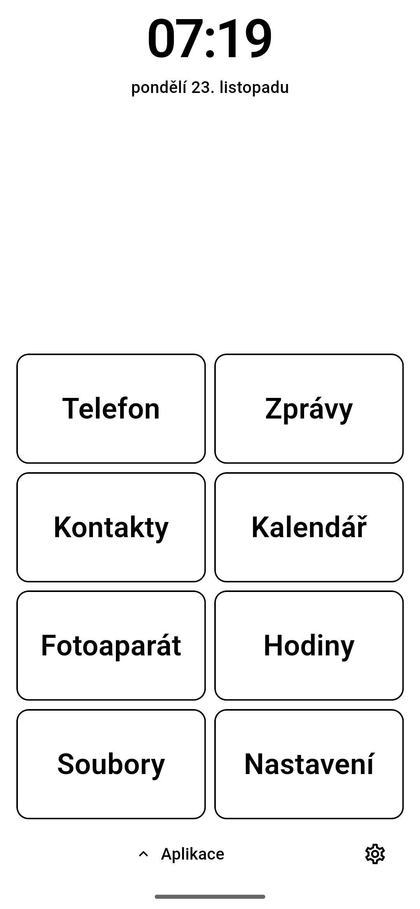
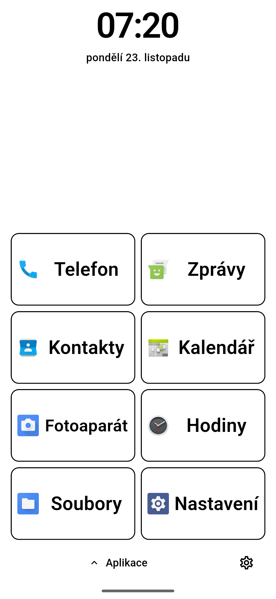
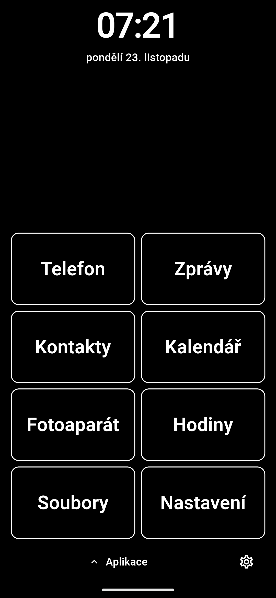
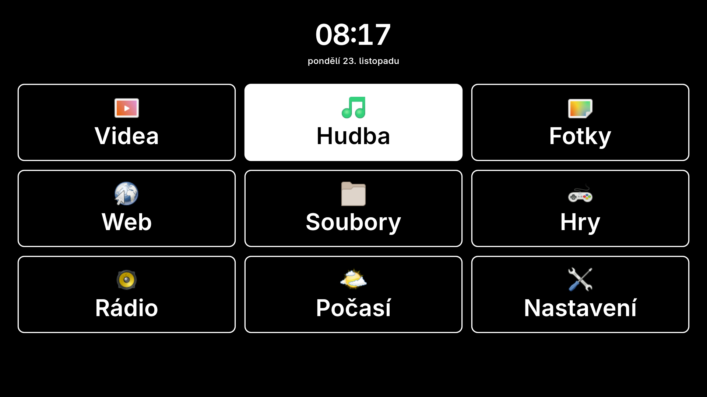

# EasyLauncher

[English](README.md) | **Čeština**

EasyLauncher je lehký spouštěč aplikací s textovými dlaždicemi a českým
rozhraním, určený hlavně pro telefony s Androidem a černobílým displejem e-ink.
Výchozí plocha na Androidu má velké dlaždice, černý text na bílém pozadí a
přechody bez animací. Ikony aplikací a režim s čistě černým pozadím si můžeš
zapnout v nastavení. Na Linuxu funguje i jako celoobrazovková plocha pro
televizi, kterou ovládáš klávesnicí nebo dálkovým ovladačem.

<p>
  
  
  
</p>

## Android

### Ovládání plochy

V nastavení EasyLauncheru otevři **Výchozí domovská obrazovka** a v Androidu
vyber EasyLauncher jako výchozí aplikaci plochy.

- Klepnutím na dlaždici spustíš oblíbenou aplikaci. Dlouhým podržením ji můžeš
  přejmenovat, odebrat z oblíbených, změnit její pořadí nebo otevřít informace
  o aplikaci v Androidu. Při přejmenování vloží Enter nový řádek. Název uložíš
  tlačítkem **Uložit**.
- Přejetím nahoru nebo klepnutím na **Aplikace** otevřeš abecední seznam
  ostatních aplikací. Při hledání můžeš vynechat diakritiku. Podrž položku
  a zvol **Přidat k oblíbeným**, aby se aplikace objevila na ploše.
- Přejetím dolů na začátku seznamu nebo přes jeho záhlaví se vrátíš na plochu
  a zavřeš klávesnici. Na oblíbené tě vrátí i systémové tlačítko Domů.
- Klepnutím na hodiny otevřeš budík a klepnutím na datum kalendář. Přejetím
  doleva otevřeš fotoaparát, doprava kontakty. Všechny čtyři cílové aplikace
  můžeš změnit v nastavení.
- Přejetím dolů na ploše otevřeš panel oznámení Androidu. Pokud se mřížka
  oblíbených posouvá, začni svislé gesto nad ní.

Výchozí plocha má černý text na bílém pozadí a dva sloupce textových dlaždic.
V nastavení můžeš přepnout na tři sloupce, změnit velikost názvů na dlaždicích
a vypnout automatické otevírání klávesnice v seznamu aplikací. **Tmavý režim**
má černé pozadí a bílý text. Přepínač **Ikony aplikací** zapíná ikony na
ploše a v seznamu nezávisle na zvoleném režimu. Ve dvou sloupcích jsou ikony
vedle názvu, ve třech nad ním. V seznamu jsou vedle názvu.

Pro gesto oznámení povol službu **Otevření oznámení** v nastavení zpřístupnění
Androidu. Služba pouze otevírá panel oznámení a nemůže číst jeho obsah ani
obsah jiných oken. Vydané APK nežádá o oprávnění k internetu, fotoaparátu,
kontaktům ani kalendáři. Zkratky otevírají další aplikace přes Android.

### Sestavení a instalace

Pro sestavení a testy použij Flutter 3.50.1 (Dart 3.14.0). Příkazy spouštěj
z kořenové složky projektu.

EasyLauncher vyžaduje Android 7.0 (API 24) nebo novější. K sestavení APK pro
ARM64 potřebuješ Android SDK, JDK kompatibilní s přibaleným Gradlem a Python 3.
Pro instalaci přes `adb` připoj telefon se zapnutým laděním přes USB.

```sh
flutter pub get
python3 tool/build_apk.py
adb install -r build/app/outputs/flutter-apk/app-release.apk
```

APK je podepsané vývojovým klíčem. Pro distribuci si v projektu pro Android
nastav vlastní podpisový klíč. Ladicí APK sestavíš s přepínačem `--debug`.

### Vlastní výchozí profil

Pokud chceš začít s předvolenými oblíbenými aplikacemi a nastavením, sestav APK
s profilem.

```sh
python3 tool/build_apk.py --profile private/launcher-profile.json
```

Profil se použije, když EasyLauncher ještě nemá uložené nastavení. Při
aktualizaci se použije nastavení uložené v telefonu. Osobní profily ukládej
do ignorované složky `private/`. Při sestavení se profil vloží do APK, proto
veřejné verze sestavuj bez přepínače `--profile`.

Soubor JSON musí obsahovat `schemaVersion` s hodnotou `1` a pole `favorites`
v pořadí dlaždic. Každá položka má `packageName`, úplný název aktivity
v `activityName` a popisek `label`. S prázdným polem začneš bez oblíbených.
Ostatní nastavení jsou volitelná.

- `layout.favoriteColumns` má hodnotu `2` nebo `3`. `layout.fontSize` je
  v rozsahu `18` až `36`.
- `autoKeyboard`, `darkMode` a `showAppIcons` mají hodnotu `true` nebo
  `false`.
- `labels` přiřazuje vlastní názvy k identifikátorům ve tvaru
  `packageName/activityName`.
- V `actions` můžeš použít klíče `clockTap`, `dateTap`, `swipeRight` a
  `swipeLeft`. Každá akce má stejné položky jako aplikace a navíc
  `"type": "launchApp"`.

## Televizní plocha pro Linux



Televizní plocha se otevře na celé obrazovce s černým pozadím, hodinami,
datem a oblíbenými aplikacemi ve třech sloupcích. Mřížka se přizpůsobí
velikosti obrazovky. Dlaždici vybereš šipkami na klávesnici nebo ovladači,
který posílá stejné klávesové události. Zvýrazněnou dlaždici spustíš Enterem.
Najetím myší ji zvýrazníš, kliknutím spustíš. Mezi dvěma spuštěními musí
uplynout tři sekundy.

### Nastavení oblíbených

Vytvoř soubor `$XDG_CONFIG_HOME/easylauncher/apps.json`. Pokud je
`XDG_CONFIG_HOME` prázdná nebo nenastavená, použij
`~/.config/easylauncher/apps.json`. Nastav `schemaVersion` na `1` a do
`favorites` zapiš dlaždice v pořadí, v jakém je chceš zobrazit. Každá položka
potřebuje neprázdný název `label` a příkaz `command`. Příkazy se spouštějí
přes `/bin/sh` a můžou mít argumenty. Pokud se příkaz nenajde, při spuštění
dlaždice se zobrazí chybová zpráva. Volitelná položka `icon` zobrazí
místní obrázek nad názvem. Použij absolutní cestu k souboru PNG, JPEG nebo
WebP. Když se obrázek nepodaří načíst, název zůstane vidět.

```json
{
  "schemaVersion": 1,
  "favorites": [
    {"label": "Kodi", "command": "kodi", "icon": "/path/to/icons/kodi.png"},
    {"label": "ScummVM", "command": "scummvm"}
  ]
}
```

Po úpravě souboru EasyLauncher spusť znovu. Pokud soubor chybí, je neplatný
nebo má prázdný seznam, plocha tě na něj odkáže.

### Sestavení a spuštění

Pro sestavení na Linuxu si připrav nástroje pro Flutter. Patří k nim
Clang, CMake, Ninja, pkg-config a vývojové knihovny GTK 3. Postup najdeš
v [návodu k nastavení Flutteru pro Linux](https://docs.flutter.dev/platform-integration/linux/setup).

```sh
flutter build linux --release
```

Složku `bundle` ponech pohromadě a spusť z ní soubor `easylauncher`.
Pro labwc nainstaluj Xwayland a přidej následující řádek do souboru
`~/.config/labwc/autostart` (nebo `$XDG_CONFIG_HOME/labwc/autostart`, pokud
používáš vlastní konfigurační složku). Použij absolutní cestu ke svému
sestavení a složku pro architekturu, kterou vypíše Flutter.

```sh
GDK_BACKEND=x11 "/path/to/easylauncher/build/linux/x64/release/bundle/easylauncher" &
```

Při nativním běhu na Waylandu pod labwc může vykreslovací vlákno Flutteru
3.50.1 uvíznout ve smyčce. Při měření provádělo asi 4 000 synchronizací
se zobrazovacím serverem za sekundu a spotřeba byla o 2,8 W vyšší než přes
Xwayland, kde bylo vykreslovací vlákno v klidu. Aplikace spuštěné z televizní
plochy zdědí `GDK_BACKEND=x11`. Proměnnou ponech, dokud oprava nebude
součástí stabilního vydání Flutteru. Jde o
[chybu Flutteru #196529](https://github.com/flutter/flutter/issues/196529).

## Testování

Celou sadu testů spusť na Linuxu. Testy spouštění procesů používají
`/bin/sh` a `/proc`.

```sh
flutter pub get
flutter analyze
flutter test
```

Testy pokrývají nastavení a hledání, gesta a navigaci na Androidu, hodiny,
tmavý režim a ikony aplikací. Ověřují taky konfiguraci pro Linux, spouštění
příkazů a ovládání televizní plochy klávesnicí a myší.

Integrační test pro Android spusť na připojeném zařízení.

```sh
flutter test integration_test/app_test.dart -d DEVICE_ID
```

Test ověří seznam aplikací z Androidu, načte uložené nastavení, zkontroluje
odmítnutí spuštění nedostupné aplikace a vyzkouší otevření seznamu, hledání
i návrat na plochu. Ladicí aplikace má vlastní identifikátor a nastavení.

Verze 0.2.1 byla ověřena při následujícím použití.

- Každodenní plocha na ONYX BOOX Palma (Android 11, zapnuté ikony aplikací).
- Každodenní plocha na Bigme HiBreak Pro BW (Android 14, systémová velikost
  písma 180 %).
- Zkušební instalace na telefonu Samsung Galaxy A35 (Android 16) bez změny
  výchozí plochy.
- Televizní plocha pro Linux pod labwc přes Xwayland.

## Licence

EasyLauncher je dostupný pod licencí GNU General Public License v3.0. Plné
znění je v souboru [LICENSE](LICENSE).
