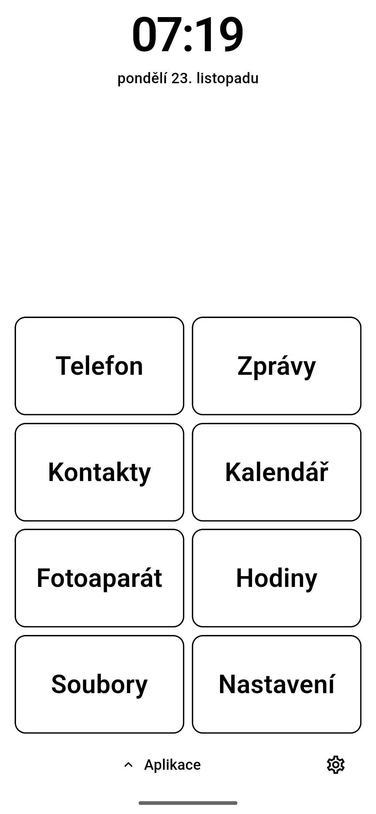
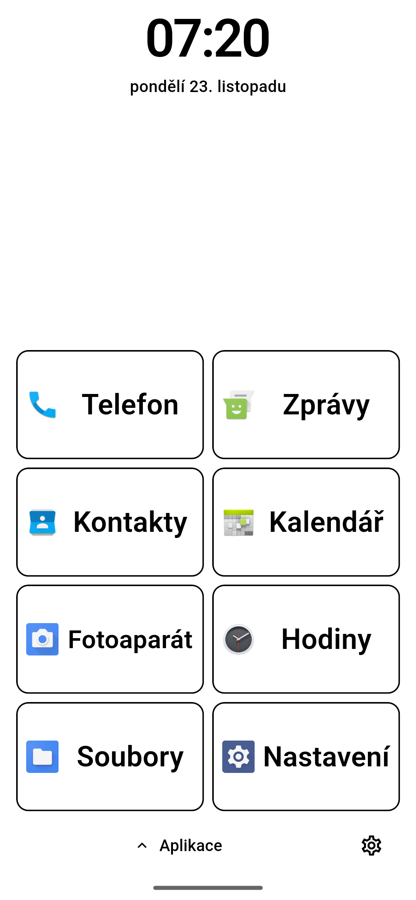
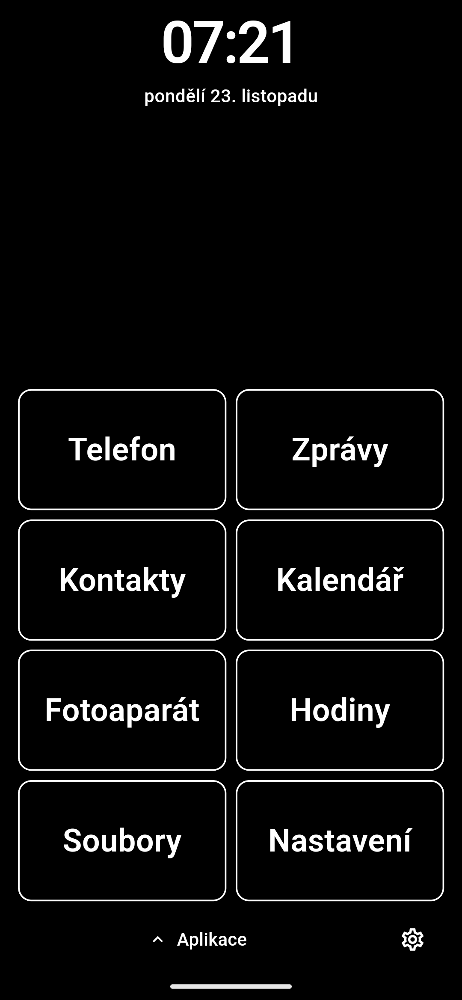
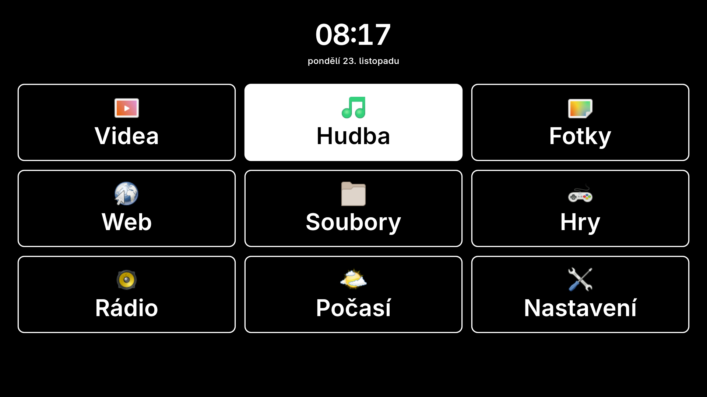

# EasyLauncher

**English** | [Čeština](README.cs.md)

EasyLauncher is a lightweight, text-first launcher with a Czech interface,
made mainly for Android phones with monochrome e-ink displays. The default
Android home uses large tiles, black text on white, and no animated
transitions. App icons and a pure black theme are optional. On Linux it also
runs as a fullscreen TV home controlled with a keyboard or remote.

<p>
  
  
  
</p>

## Android

### Use the home screen

To make EasyLauncher your home app, open **Default home screen** in its
settings and choose EasyLauncher in Android.

- Tap a favorite tile to open its app. Hold and drag the tile to move it.
  Hold and release it in place to open the menu for renaming, removing it from
  favorites, or viewing Android app info. When renaming, Enter inserts a line
  break. Tap **Save** to save the name.
- Swipe up or tap **Apps** to open the alphabetical list of other apps.
  Search ignores diacritics. Long-press an app and choose **Add to favorites**
  to pin it to the home screen.
- Swipe down from the top of the app list or over its header to return home and
  close the keyboard. The system Home button also returns to the favorites.
- Tap the clock for alarms or the date for the calendar. Swipe left for the
  camera or right for contacts. You can change all four targets in settings.
- Swipe down on the home screen to open the Android notification shade. If the
  favorites grid scrolls, start vertical gestures above it.

The default home screen uses black text on white, with two columns of
text-only tiles. Settings let you use three columns, change tile label size,
and turn off automatic opening of the keyboard in the app list.
**Dark mode** uses a pure black background with white text. **App icons** is
a separate switch for icons on the home screen and in the app list. Home
tiles show icons beside the label in two columns and above it in three.
The app list shows them beside the label.

For the notification gesture, enable **EasyLauncher** in Android
accessibility settings. The service only opens the notification shade and
cannot read its contents or other windows. The release APK requests no
internet, camera, contacts, or calendar permissions. The shortcuts open other
apps through Android.

### Build and install

Build and test from the project root with Flutter 3.50.1 (Dart 3.14.0).
EasyLauncher requires Android 7.0 (API 24) or newer. To build the ARM64 APK,
install the Android SDK, a JDK compatible with the Gradle wrapper, and Python 3.
For installation with `adb`, connect your phone with USB debugging enabled.

```sh
flutter pub get
python3 tool/build_apk.py
adb install -r build/app/outputs/flutter-apk/app-release.apk
```

The APK uses a development signing key. Configure your own signing key in
the Android project for distribution. Pass `--debug` to the script to build
a debug APK.

### Seed a personal profile

To start with a set of favorites and settings, build with a profile.

```sh
python3 tool/build_apk.py --profile private/launcher-profile.json
```

The profile supplies defaults when EasyLauncher has no saved settings.
Updates use the settings already saved on the phone. Keep personal profiles
in the ignored `private/` directory. The build embeds the profile in the APK,
so omit `--profile` for public builds.

The JSON file requires `schemaVersion` set to `1` and a `favorites` array in
tile order. Each app entry has a `packageName`, a fully qualified
`activityName`, and a `label`. Use an empty array to start without favorites.
The other settings are optional.

- `layout.favoriteColumns` is `2` or `3`. `layout.fontSize` is between `18`
  and `36`.
- `autoKeyboard`, `darkMode`, and `showAppIcons` take `true` or `false`.
- `labels` maps a `packageName/activityName` to a custom display name.
- `actions` accepts `clockTap`, `dateTap`, `swipeRight`, and `swipeLeft`.
  Each action uses the same app fields, plus `"type": "launchApp"`.

## Linux TV home



The TV home opens fullscreen with a black background, a clock, date, and a
three-column favorites grid that scales to fit the screen. Use the arrow
keys on a keyboard or a remote that sends those keys. Press Enter to launch
the highlighted tile. Moving the mouse over a tile highlights it and
clicking opens it. The launcher waits three seconds before accepting
another launch.

### Configure favorites

Create `$XDG_CONFIG_HOME/easylauncher/apps.json`. If `XDG_CONFIG_HOME` is
unset or empty, use `~/.config/easylauncher/apps.json`. Set `schemaVersion`
to `1` and put the tiles in display order in `favorites`. Each entry needs a
nonempty `label` and `command`. Commands run through `/bin/sh` and can
include arguments. Opening a tile whose command cannot be found shows an
error message. The optional `icon` is a local image above the label.
Use an absolute path to a PNG, JPEG, or WebP file. If the image cannot load,
the label stays visible.

```json
{
  "schemaVersion": 1,
  "favorites": [
    {"label": "Kodi", "command": "kodi", "icon": "/path/to/icons/kodi.png"},
    {"label": "ScummVM", "command": "scummvm"}
  ]
}
```

Restart EasyLauncher after editing the file. The home screen points you
to the file if it is missing or invalid, or if the list is empty.

### Build and start

Build on Linux with the Flutter desktop toolchain, including Clang, CMake,
Ninja, pkg-config, and the GTK 3 development libraries. See the
[Flutter Linux setup guide](https://docs.flutter.dev/platform-integration/linux/setup).

```sh
flutter build linux --release
```

Keep the whole `bundle` directory together and start its `easylauncher`
executable. For labwc, install Xwayland and put this line in
`~/.config/labwc/autostart` (or `$XDG_CONFIG_HOME/labwc/autostart` if you use a
custom config directory). Use the absolute path to your build and the
architecture directory that Flutter reports.

```sh
GDK_BACKEND=x11 "/path/to/easylauncher/build/linux/x64/release/bundle/easylauncher" &
```

On native Wayland under labwc, Flutter 3.50.1's raster thread can spin.
A measurement showed about 4,000 round trips to the display server per
second and 2.8 W more power use than with Xwayland, where the raster thread
idled. Apps started from the TV home inherit `GDK_BACKEND=x11`. Keep the
override until a stable Flutter release includes the fix for
[Flutter issue #196529](https://github.com/flutter/flutter/issues/196529).

When you start labwc without a mouse, it still shows the pointer near the
top-left corner, and apps cannot hide it. With labwc 0.8.4 or newer, you can
hide it every time a window opens, until you use the mouse again. Put this
rule in `~/.config/labwc/rc.xml` (or `$XDG_CONFIG_HOME/labwc/rc.xml` if you
use a custom config directory). If the file already exists, add the
`windowRule` to its `windowRules` section. labwc reads only the first
`rc.xml` it finds, so if you have none yet but your system provides
`/etc/xdg/labwc/rc.xml`, start from a copy of that file.

```xml
<?xml version="1.0"?>
<labwc_config>
  <windowRules>
    <windowRule identifier="*">
      <action name="HideCursor"/>
    </windowRule>
  </windowRules>
</labwc_config>
```

## Testing

Run the full test suite on Linux. The process tests use `/bin/sh` and `/proc`.

```sh
flutter pub get
flutter analyze
flutter test
```

The tests cover settings and search, Android gestures and navigation, the
clock, dark mode, and app icons. They also check the Linux configuration,
shell launches, and keyboard and mouse controls on the TV home.

Run the Android integration test on a connected device.

```sh
flutter test integration_test/app_test.dart -d DEVICE_ID
```

It checks native app discovery, reads back saved settings, checks that an
unavailable app is rejected, and opens, searches, and dismisses the app list.
The debug app has its own application ID and settings.

Version 0.2.1 was tested in these setups.

- Daily home screen on ONYX BOOX Palma (Android 11, app icons enabled).
- Daily home screen on Bigme HiBreak Pro BW (Android 14, system font scale 180%).
- Installed for testing on Samsung Galaxy A35 (Android 16), not as the default home.
- Linux TV home under labwc through Xwayland.

## License

EasyLauncher is licensed under the GNU General Public License v3.0. See
[LICENSE](LICENSE).
